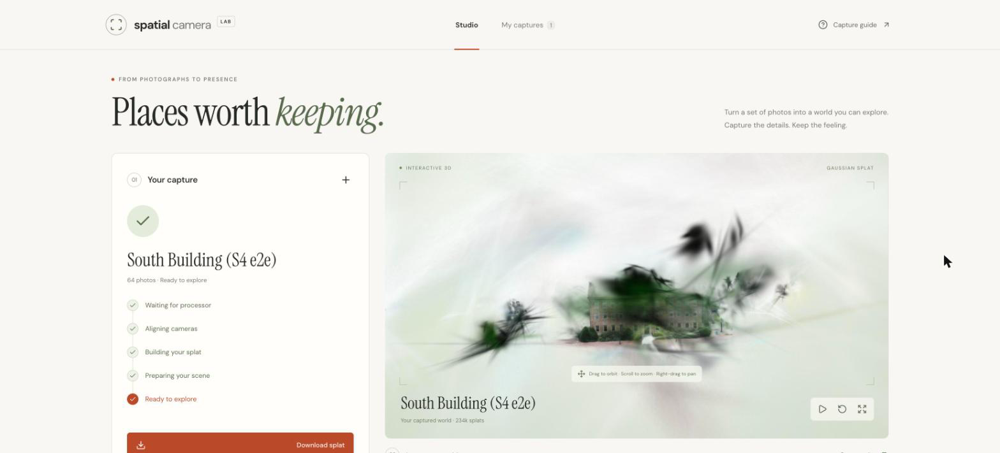

# S4 end to end on the Mac: local dev server + `worker:mac` → viewer

- **Date:** 2026-11-22
- **Branch:** `m0-m1-delivery` @ `5322765` plus the uncommitted S4 changes (`mac_pipeline.py`, `setup_mac.py`, tests, `.gitignore`, docs). `worker.py` is unchanged from HEAD.
- **Machine:** Apple M1 Pro (8 CPU cores, 14 GPU cores), 16 GB, macOS 27.2.1. See the dry-run log for the full spec.
- **Dataset:** COLMAP *South Building*, the same 64 originals as the dry run (`.local/datasets/south-building/images/`). That is 3072×2304 JPEG, 116,981,298 bytes in total, EXIF orientation 1. No licence is stated, so the dataset is for local testing only.
- **Capture:** `9dab1630-5465-4009-acf7-234350f6b611`, "South Building (S4 e2e)"

## Verdict

**S4 DoD met.** `setup:mac` works. 64 public photos went from the local dev server through `npm run worker:mac` to `ready` in **21.9 min**, from queued to ready. The result opens upright in the Studio viewer: [screenshot](2026-11-22-s4-viewer.png). **D7 is fixed** in the pipeline by gravity alignment to +Z, with no viewer change.

The first attempt failed because the Mac **went to sleep for 17 min during training**, which expired the 10-minute lease. The second attempt ran under `caffeinate` and succeeded. Details are under "Attempt 1" below.



## How it was run

```bash
npm run setup:mac                       # re-run: existing brush_app matched the pinned sha256 (no download); .dev.vars mode 0600
npm run dev -- --port 3000              # predev applied the local D1 migrations
npm run worker:mac                      # worker.py --backend brush --env-file .dev.vars
caffeinate -dimsu -w <worker pid>       # added before attempt 2 (see below)
```

The capture was created through the HTTP API, as the Studio upload does, with the local owner (`LOCAL_DEV=true` on localhost):

1. `POST /api/captures` with the manifest.
2. 64 × `PUT /api/captures/:id/images/:imageId`, taking **17.6 s** for 117 MB.
3. `POST /api/captures/:id/submit`.

For attempt 2, I re-submitted the failed capture with `POST …/submit`, which moves it from failed back to queued.

For the screenshot, I opened the Studio in Chrome → My captures → the capture row → zoomed in with the scroll wheel.

## Timings: captures row (attempt 2, success)

| Column | Value (local time, +07) |
|---|---|
| `queued_at` | 23:20:09 |
| `aligning_at` | 23:20:18 |
| `training_at` | 23:26:26 |
| `exporting_at` | 23:42:04 |
| `ready_at` | 23:42:05 |
| `failed_at` | NULL |
| `alignment_ratio` | **NULL**. `worker.py` at HEAD sends no `metrics.alignment_ratio`. From `alignment.json`: 64/64 registered = 1.00. |
| `result_bytes` | 35,515,674 (PLY, 233,649 splats, SH degree 2) |

| Stage | Duration |
|---|---|
| queued → aligning (claim) | 8.6 s |
| aligning → training (download 64 photos + COLMAP) | 6.1 min (368 s) |
| training → exporting (Brush, 7000 steps) | 15.6 min (938.5 s) |
| exporting → ready (validate + upload 35.5 MB) | 1.4 s |
| **queued → ready** | **21.9 min** |

Alignment breakdown, from `alignment.log`, at 8 threads with 1200 px max:

| Step | Time |
|---|---|
| SIFT extraction (8192 features) | 1.34 min |
| Exhaustive matching | 2.95 min |
| Incremental mapping | 1.64 min |
| Undistortion | ~4 s |

`alignment.json`:

```json
{"registered": 64, "total": 64, "points": 40965, "matcher": "exhaustive", "threads": 8,
 "exif_rotated": 0, "gravity": {"method": "camera-up", "tilt_degrees": 72.7}}
```

The log also showed "Gravity-aligned the model (camera-up, rotated 72.7 degrees)", which matches the 72° tilt the dry run measured. The Brush PLY header still says "Vertical axis: y". That is Brush's fixed comment; the viewer ignores it, and the data is Z-up.

**Load caveat.** The machine was heavily shared throughout. Load average was 48–80 at the start of attempt 2 and fell to about 12 by the end. Swap was 19.5 of 20.5 GB used, and a VM, Chrome, IDEs and other agents were running. These numbers are close to the idle dry run (5.8 + 17.1 min), but treat them as an upper-middle estimate, not a benchmark.

## Attempt 1 (failed: Mac slept, lease expired)

| Column | Value |
|---|---|
| `queued_at` | 22:21:44 |
| `aligning_at` | 22:21:52 |
| `training_at` | 22:49:01 (alignment 27.2 min under load average ~55–150, with extraction alone 15.2 min) |
| `failed_at` | 23:17:44, "The processor stopped responding. Retry this capture when it reconnects." |

Alignment had succeeded: 64/64 photos, 40,949 points, exhaustive matching, gravity camera-up 73.8°.

**Cause.** The macOS power log shows the system sleeping through most of training:

1. `pmset -g log` at 23:00:56: "Entering Sleep state due to 'Maintenance Sleep'".
2. 23:17:36: "DarkWake from Deep Idle".

That is 16 min 40 s with no heartbeats, longer than `LEASE_TTL_MS` (10 min). On wake, the lazy `isStale` check expired the job, and the worker's next heartbeat PATCH got 409. The worker then aborted Brush and logged "Could not report failure; the server will expire the job lease." This is the designed behaviour (D1/T1). The fix is operational: keep the Mac awake.

The README Mac section now runs the worker as `caffeinate -i npm run worker:mac` and explains why.

## Review follow-up: pitch-invariant gravity re-check (2026-11-23)

The S4 review found that the mean-camera-up estimate is biased by pitch when the path is not a closed orbit: up = cos θ·Z + sin θ·forward, and the forward terms cancel only over a full circle. `estimate_up` now uses the camera right axes first (`camera-right`, spec §4). Synthetic checks (`test_mac_pipeline.py`):

| Path | New (`camera-right`) error | Old mean-up error |
|---|---|---|
| Half arc (180°), 30° downward pitch, ±3° roll | 0.39° | 20.0° |
| Full orbit, 30° downward pitch, ±3° roll | 1.04° | (cancels; ~1°) |
| Facade walk, ±20° yaw, 15° upward pitch, ±2° roll | 0.56° | 14.7° |

The right-axis estimate is unbiased but somewhat more sensitive to random roll than the mean on a full orbit. Over 200 random draws with ±5° roll on a 30-camera orbit, the median error was 0.74° (95th percentile 1.68°); the old estimate gave 0.49° (1.10°).

Real data: the e2e attempt-2 sparse model was removed with the worker's temp dir. The re-check used the dry-run model of the same 64 photos (`.local/runs/20261122-212521/dataset/sparse/0`, original COLMAP frame), re-running only the estimate, not training:

| | Up (COLMAP frame) | Tilt to +Z |
|---|---|---|
| Old (mean camera up, \|mean\| = 0.961) | (0.0218, −0.9524, 0.3042) | 72.3° (72.7° in the e2e run's own frame) |
| New (`camera-right`) | (−0.0065, −0.9473, 0.3203) | 71.3° |
| Angle between the two estimates | | **1.9°** |

The right axes are clearly planar: singular values 5.95, 5.35 and 0.19, so the thinnest/middle ratio is 0.036 against the 0.3 limit. Relative to the new up, cameras look up 15.9° on average (range 8–22°) with roll σ 1.4° (max 4.3°). South Building is close to a full orbit, so the old bias was small here. The e2e result and screenshot stand. The new method mainly matters for half-orbit and facade captures.

## Checks

| Command | Result |
|---|---|
| `python3 -m unittest discover -s gpu-worker/tests` | **77 tests OK** (16 in `test_mac_pipeline.py`, 6 in `test_setup_mac.py`). After the review follow-up: **92 OK**, 1 skipped (27 in `test_mac_pipeline.py`, 10 in `test_setup_mac.py`, 55 in `test_worker.py`; the skip is the real-pycolmap test) |
| same with `.local/venv/bin/python` (has pycolmap) | after the follow-up: 92 OK, 0 skipped |
| same with `python3 -S` (no numpy/Pillow, as in CI) | 77 run, OK, **8 skipped**. After the follow-up: 92 run, OK, **15 skipped** |
| `python3 -m py_compile gpu-worker/*.py` | OK |
| `npm run typecheck` | OK |
| `npm run lint` | **Fails, but not on repo code.** All 36 reported files are in `.claude/worktrees/agent-*/` (other agents' untracked worktrees, including built `dist/` output). `npx eslint . --ignore-pattern .claude` exits 0. |
| `npm test` | 17/17 pass |

## Findings / follow-ups (not fixed here; outside S4's edit scope)

1. **worker.py: SIGTERM handling is clobbered by `import pycolmap`.**
   - Cause: `main()` installs `EXIT_SIGNALS` (line 479) and then does a preflight `import pycolmap` (line 506). pycolmap's glog then installs its failure-signal handler for SIGTERM at the C level.
   - Reproduced: Python SIGTERM handler, then `import pycolmap`, then `kill -TERM self` gives "*** SIGTERM received … stack trace" and the Python handler never runs.
   - Observed when the worker was stopped after this run.
   - Effect: a SIGTERM during a job skips the graceful path (terminate the stage's process group, report failure). This can orphan `brush_app`. Ctrl-C (SIGINT) is unaffected.
   - Fix: `importlib.util.find_spec("pycolmap")` instead of importing, or install signals after the check.
2. **worker.py: keep the Mac awake during a job.** For example, run Brush stages under `caffeinate -i -w <pid>`, or hold an assertion while a job is active, so the README instruction isn't load-bearing.
3. **worker.py: send `metrics.alignment_ratio`** (registered/total from `alignment.json`) so the `alignment_ratio` column is populated.
4. **worker.py: run Brush with its cwd in the job's temp dir.** Brush writes `target/autotune` to the cwd (now gitignored). Deferred until after S5 merges, because S5 is changing `worker.py`.
5. **CI:** the worker job has no numpy/Pillow, so 15 S4 tests skip there (8 before the review follow-up). Suggest `pip install numpy Pillow` in `.github/workflows/ci.yml`.
6. **Viewer framing (S5):** the initial camera frames the whole splat, including floaters, so the building starts small. The screenshot needed about 25 scroll-wheel steps of zoom.
7. **Untested:** a real portrait phone capture. EXIF normalisation is unit-tested with a synthetic orientation 6 JPEG, but not end to end.

## Artifacts (local, gitignored)

`.local/e2e/`:

- `dev.log`, `worker.log`, `worker-attempt1.log`
- `alignment-attempt2.log`, `artifacts/alignment.json`, `alignment-attempt1.json`
- `capture-ready.json` (the GET response)
- `result.ply` (downloaded result)
- `lint.log`
